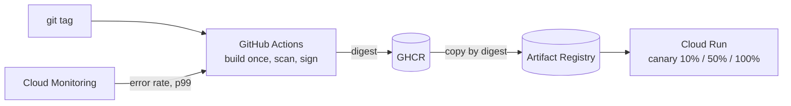

# zero-downtime-ml-serving

Every new model version reaches production without dropping a request, and a version that degrades rolls itself back.
Images are built once and promoted by digest; Cloud Run shifts traffic to a canary revision step by step and rolls back automatically when Cloud Monitoring shows errors or latency.

<!-- CI badges go here once the workflows exist. -->



## Quick start

```bash
just up
```

## What runs where

| Capability | Local | Tested in CI | Live on dev / plan-only |
|---|---|---|---|
| _filled in as phases land_ | | | |

## Repository layout

```text
app/            model server (FastAPI + scikit-learn)
bootstrap/      one-time Terraform: GCP projects, state buckets, WIF, CI service accounts, budgets
modules/        Terraform modules by topic: registry, service, observability
envs/           dev and prod compositions, differ only by tfvars
tests/load/     k6 load scripts
tools/          scripts called by the justfile
docs/           ADRs, runbook, SLOs
```

## Deploying to GCP

_To be written._
