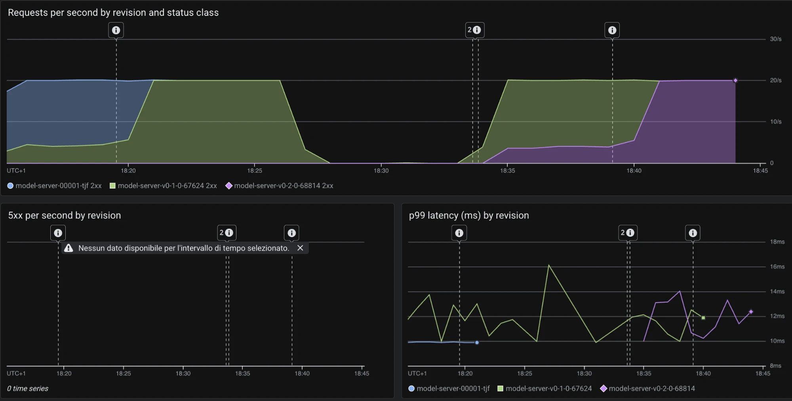
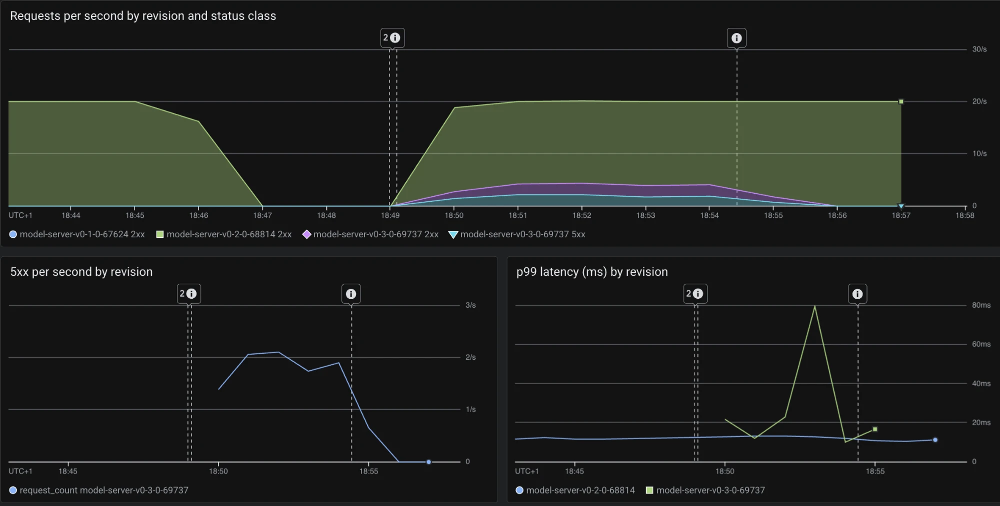
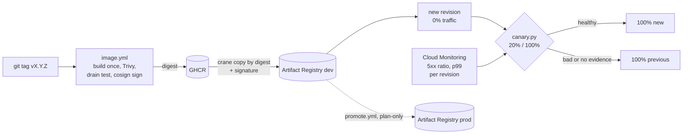

# zero-downtime-ml-serving

[](https://github.com/TechTutter/zero-downtime-ml-serving/actions/workflows/ci.yml)
[](https://github.com/TechTutter/zero-downtime-ml-serving/actions/workflows/image.yml)

Every new model version reaches production without dropping a request, and a version that degrades rolls itself back.
The image is built once and promoted by digest; Cloud Run shifts traffic to the new revision 20% then 100% and returns it to the previous one as soon as Cloud Monitoring shows errors or latency.

## Proven on a live project

Run end to end on a GCP dev project (free trial) under a constant k6 load of 20 requests per
second, then destroyed. Each canary step watches the new revision alone for 5 minutes.

| Release                                                                                   | Scenario                          | Canary on the new revision                                     | Failed requests (k6, 12 min) |
| ----------------------------------------------------------------------------------------- | --------------------------------- | -------------------------------------------------------------- | ---------------------------- |
| [v0.1.0](https://github.com/TechTutter/zero-downtime-ml-serving/actions/runs/45048168188) | replaces the placeholder revision | 20%: 0.00% errors, p99 14 ms; 100%: 0.00%, p99 13 ms; promoted | 0 of 14,401                  |
| [v0.2.0](https://github.com/TechTutter/zero-downtime-ml-serving/actions/runs/45049916346) | new release under load            | 20%: 0.00% errors, p99 14 ms; 100%: 0.00%, p99 13 ms; promoted | 0 of 14,401                  |
| [v0.3.0](https://github.com/TechTutter/zero-downtime-ml-serving/actions/runs/45051493602) | v0.2.0 image, 50% injected 5xx    | 20%: 47.86% errors against a 5% limit; rolled back to v0.2.0   | 589 of 14,400 (4.09%)        |

The degraded release failed 4.09% of all requests, below its 20% traffic share: errors stayed
inside the canary slice and stopped at the rollback.

| v0.2.0: traffic moves to the new revision, the total stays flat, no 5xx | v0.3.0: 5xx on the canary slice, then all traffic back on v0.2.0 |
| ----------------------------------------------------------------------- | ---------------------------------------------------------------- |
|                     |            |

## How a release works



The signature is verified before every copy, and the digest must match after it. Too little
traffic to judge counts as a failure, so the canary fails safe. `promote.yml` ships the digest
that passed dev to prod with the same canary. Decisions are in [docs/adr](docs/adr); operations
in the [runbook](docs/runbook.md) and [SLOs](docs/slo.md).

## Quick start

```bash
just up
```

Builds the image and serves it on <http://localhost:8080> (`just smoke` to call it).
Needs Docker and [just](https://github.com/casey/just); `just` lists every task.

## What runs where

| Capability                                     | Local             | Tested in CI                                     | Live on dev   |
| ---------------------------------------------- | ----------------- | ------------------------------------------------ | ------------- |
| Model server, probes, `/version`, `/metrics`   | `just up`         | pytest (`ci.yml`)                                | yes           |
| No request lost on SIGTERM                     | `just drain-test` | every image (`image.yml`)                        | yes           |
| Keyless signing, copy by digest with signature |                   | two local registries (`image.yml`)               | GHCR → AR dev |
| Canary decision logic                          | `just test`       | pytest on `tools/canary.py`                      | yes           |
| Canary under load, automatic rollback          |                   |                                                  | `deploy.yml`  |
| Terraform, WIF (no keys), SLO, alerts          | `just tf-check`   | fmt, validate, `terraform test`, tflint, checkov | applied       |

Prod is plan-only: same Terraform and workflows, never applied. Cloud Run cannot run locally,
so the canary itself is proven on dev; everything around it is tested on every pull request.

## Repository layout

```text
app/                    model server: FastAPI + scikit-learn, trained at build time, pytest
bootstrap/              one-time Terraform: dev/prod projects, state buckets, WIF, CI identities, budgets
modules/                registry (AR, cleanup), service (Cloud Run, IAM), observability (SLO, alerts, dashboard)
envs/dev, envs/prod     same composition, differences only in terraform.tfvars
tests/load/, tools/     k6 load; scripts behind the justfile (canary.py, deploy, copy, verify, drain test)
.github/workflows/      ci, image, deploy, infra (+ _apply), promote
docs/                   ADRs, runbook, SLOs, evidence screenshots
```

| Environment | Access            | Scaling           | Protection                             | Status            |
| ----------- | ----------------- | ----------------- | -------------------------------------- | ----------------- |
| dev         | public            | 0 to 2 instances  | none, disposable                       | live during demos |
| prod        | IAM invokers only | 1 to 10 instances | deletion protection, required reviewer | plan-only         |

## Deploying to GCP

Needs a billing account (the free trial works), an existing project to use as quota project,
`gcloud`, Terraform >= 1.9, `gh` and `jq`.

1. `gcloud auth application-default login`. Bootstrap bills its API calls to the quota project:
   ```bash
   gcloud services enable cloudresourcemanager.googleapis.com cloudbilling.googleapis.com billingbudgets.googleapis.com serviceusage.googleapis.com iam.googleapis.com storage.googleapis.com --project <quota-project>
   ```
2. Copy `bootstrap/terraform.tfvars.example` to `terraform.tfvars`, fill in the billing account,
   then `just bootstrap`. A different `project_prefix` also goes in `envs/*/terraform.tfvars`.
3. `just gh-vars`, then create GitHub environments `dev` and `prod`, `prod` with a required reviewer.
4. Run the `infra` workflow: it applies dev, and the prod job waits for an approval never given.
5. Tag `v0.1.0` and `v0.2.0`. For the degraded run, dispatch `deploy` with the v0.2.0 digest,
   version `v0.3.0` and `fault_error_rate=0.5`: it passes only if the canary rolls back.
6. Tear down with `terraform destroy` on `envs/dev`, then on `bootstrap`, and delete the
   repository variables.

Without repository variables, `infra`, `deploy` and `promote` skip with a notice, so forks and
pull requests stay green.

## Out of scope

Kubernetes, service mesh, custom domains and external load balancers, multi-region, Vault,
multi-cloud.
