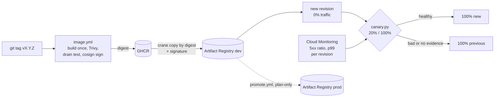

# zero-downtime-ml-serving

[](https://github.com/TechTutter/zero-downtime-ml-serving/actions/workflows/ci.yml)
[](https://github.com/TechTutter/zero-downtime-ml-serving/actions/workflows/image.yml)

Every new model version reaches production without dropping a request, and a version that degrades rolls itself back.
The image is built once and promoted by digest; Cloud Run shifts traffic to the new revision 20% then 100% and returns it to the previous one as soon as Cloud Monitoring shows errors or latency.



## Quick start

```bash
just up
```

Builds the image and serves it on <http://localhost:8080> (`just smoke` to call it).
Needs Docker and [just](https://github.com/casey/just); `just` lists every task.

## What runs where

| Capability                                     | Local             | Tested in CI                                     | Live on dev                    | Plan-only        |
| ---------------------------------------------- | ----------------- | ------------------------------------------------ | ------------------------------ | ---------------- |
| Model server, probes, `/version`, `/metrics`   | `just up`         | pytest (`ci.yml`)                                | yes                            |                  |
| No request lost on SIGTERM                     | `just drain-test` | every image (`image.yml`)                        | yes                            |                  |
| Build once, Trivy scan                         | `just up`         | `image.yml`                                      |                                |                  |
| Keyless signing, copy by digest with signature |                   | two local registries (`image.yml`)               | GHCR → AR dev                  | AR dev → AR prod |
| Canary decision logic                          | `just test`       | pytest on `tools/canary.py`                      | yes                            |                  |
| Canary under k6 load, zero errors              |                   |                                                  | `deploy.yml` on release tags   |                  |
| Degraded release rolled back automatically     |                   |                                                  | `deploy.yml` with fault inputs |                  |
| Terraform modules                              | `just tf-check`   | fmt, validate, `terraform test`, tflint, checkov | applied                        | prod             |
| Workload Identity Federation (no keys)         |                   |                                                  | yes                            | prod             |
| SLO, alerts, dashboard                         |                   | `terraform test`                                 | yes                            | prod             |

Cloud Run cannot run locally, so the canary itself is proven on the dev project; everything
around it (image, signing, promotion, decision logic, Terraform) is tested on every pull request.

## How a release works

1. `git tag v0.2.0 && git push --tags`.
2. `image.yml` builds the image once, scans it, checks that in-flight requests survive
   SIGTERM, pushes it to GHCR by digest and signs it with cosign keyless (GitHub OIDC).
3. `deploy.yml` verifies the signature, copies image and signature to Artifact Registry dev by
   digest, and deploys a revision that receives no traffic.
4. Under constant k6 load, `tools/canary.py` moves 20%, then 100% of traffic. After
   each step it reads the new revision's 5xx ratio and p99 from Cloud Monitoring.
5. A healthy release ends at 100% with zero failed requests. A bad or inconclusive step sends
   100% back to the previous revision, and the job checks that errors stayed within the 20%
   canary weight.
6. `promote.yml` copies the digest that passed dev into prod's registry and runs the same canary
   (plan-only here).

Decisions and trade-offs are in [docs/adr](docs/adr). Operations: [runbook](docs/runbook.md),
[SLOs](docs/slo.md).

## Repository layout

```text
app/                    model server: FastAPI + scikit-learn, trained at build time, pytest
bootstrap/              one-time Terraform: dev/prod projects, state buckets, WIF, CI identities, budgets
modules/registry        Artifact Registry with immutable tags and cleanup policy
modules/service         Cloud Run service, runtime identity, invoker and deployer IAM
modules/observability   availability SLO, error and latency alerts, uptime check, dashboard
envs/dev, envs/prod     same composition, differences only in terraform.tfvars
tests/load/             k6 constant-rate load
tools/                  scripts behind the justfile (canary.py, deploy, copy, verify, drain test)
.github/workflows/      ci, image, deploy, infra (+ _apply), promote
docs/                   ADRs, runbook, SLOs
```

| Environment | Access            | Scaling           | Protection                             | Status            |
| ----------- | ----------------- | ----------------- | -------------------------------------- | ----------------- |
| dev         | public            | 0 to 2 instances  | none, disposable                       | live during demos |
| prod        | IAM invokers only | 1 to 10 instances | deletion protection, required reviewer | plan-only         |

## Deploying to GCP

Requirements: a GCP billing account (the free trial works), an existing project to use as
quota project, `gcloud`, Terraform >= 1.9, `gh`, `jq`.

1. Authenticate: `gcloud auth application-default login`.
2. Bootstrap (local state, run once):
   ```bash
   cp bootstrap/terraform.tfvars.example bootstrap/terraform.tfvars   # fill in billing account
   just bootstrap
   ```
   If you change `project_prefix`, update `project_id` in `envs/*/terraform.tfvars` too.
3. Publish the outputs as repository variables and create the GitHub environments:
   ```bash
   just gh-vars
   ```
   In GitHub, create environments `dev` and `prod`; give `prod` a required reviewer.
4. Infrastructure: push to `main` (or run the `infra` workflow). It applies dev; the prod job
   waits for an approval that is never given in this repository.
5. Release: `git tag v0.1.0 && git push --tags`, then `v0.2.0` to watch a canary under load.
6. Degraded model: dispatch `deploy` with the v0.2.0 image, version `v0.3.0` and
   `fault_error_rate=0.5`. The job passes only if the canary rolls back on its own.
7. Tear down:
   ```bash
   terraform -chdir=envs/dev destroy
   terraform -chdir=bootstrap destroy
   ```

Without repository variables, `infra`, `deploy` and `promote` skip with a notice, so forks and
pull requests stay green.

## Out of scope

Kubernetes, service mesh, custom domains and external load balancers, multi-region,
Vault, multi-cloud.
