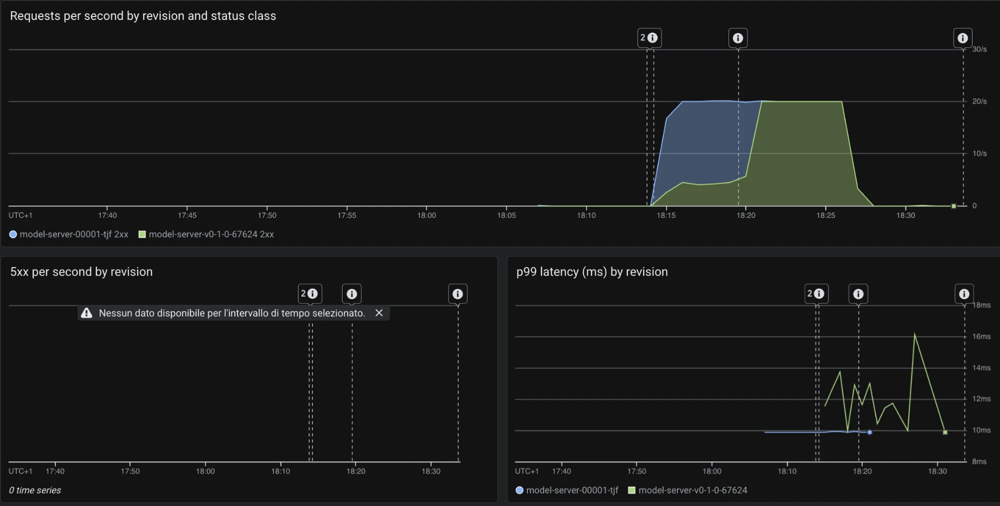
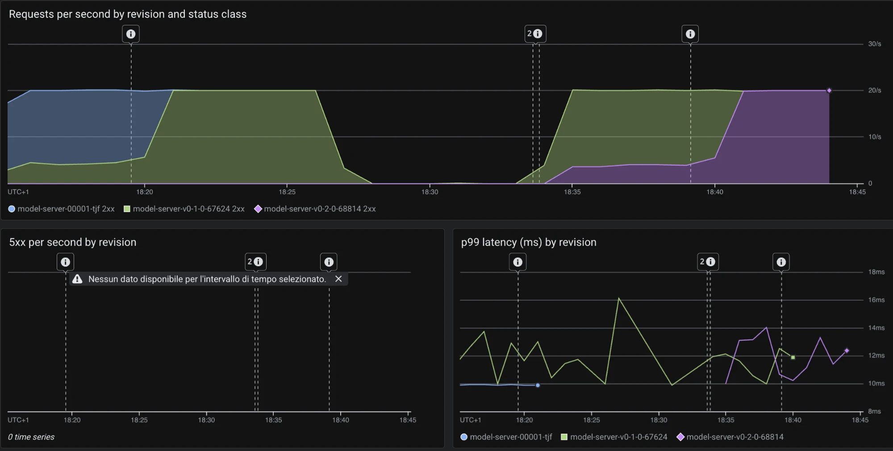
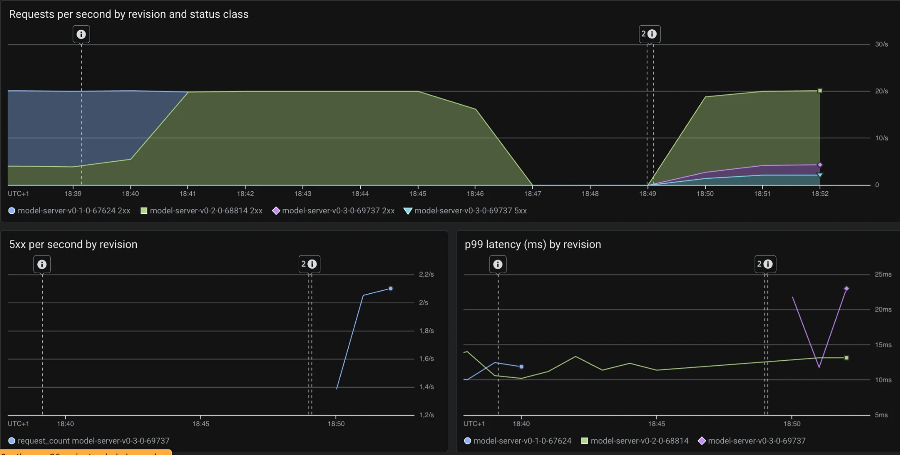
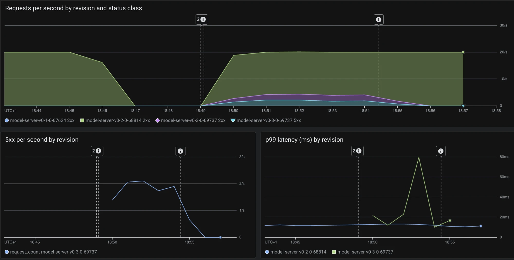

# Evidence: live run on dev

One session on 2026-11-22, on the `zdml-demo-dev` project (free trial, `europe-west1`), after
which the project was destroyed. Load was k6 at a constant 20 requests per second for 12
minutes per release. The canary sends 20% of traffic to the new revision for 5 minutes, then
100% for 5 minutes, and reads Cloud Run's built-in metrics per revision.

| Release  | What happened                                     | Canary 20%                     | Canary 100%            | k6 (whole run)                   | Run                                                                                               |
| -------- | ------------------------------------------------- | ------------------------------ | ---------------------- | -------------------------------- | ------------------------------------------------------------------------------------------------- |
| `v0.1.0` | first real revision, replaces the placeholder     | 912 req, 0.00%, 14 ms          | 5142 req, 0.00%, 13 ms | 14,401 req, 0 failed, p99 166 ms | [deploy](https://github.com/TechTutter/zero-downtime-ml-serving/actions/runs/45048168188)         |
| `v0.2.0` | new release under load                            | 917 req, 0.00%, 14 ms          | 5119 req, 0.00%, 13 ms | 14,401 req, 0 failed, p99 109 ms | [image + deploy](https://github.com/TechTutter/zero-downtime-ml-serving/actions/runs/45049916346) |
| `v0.3.0` | v0.2.0 image with `FAULT_ERROR_RATE=0.5` injected | error rate 47.86%: rolled back | not reached            | 14,400 req, 589 failed (4.09%)   | [deploy](https://github.com/TechTutter/zero-downtime-ml-serving/actions/runs/45051493602)         |

The percentages in the canary columns are the error rate of the new revision only.

## v0.1.0 and v0.2.0: no request lost

Traffic moves from one revision to the next while the total stays flat at 20 requests per
second. The 5xx panel is empty because Cloud Monitoring creates no series until the first
5xx.

Canary log of v0.1.0 (`tools/canary.py` in the deploy job):

```text
canary model-server-v0-1-0-67624, rollback target model-server-00001-tjf
[ 20%] traffic model-server-v0-1-0-67624=20,model-server-00001-tjf=80, observing for 300s
[ 20%] healthy: 912 requests, error rate 0.00%, p99 14ms
[100%] traffic model-server-v0-1-0-67624=100, observing for 300s
[100%] healthy: 5142 requests, error rate 0.00%, p99 13ms
PROMOTED: 100% traffic on model-server-v0-1-0-67624
```





## v0.3.0: a degraded model rolls itself back

During the 20% step the new revision returns 5xx on about half of its requests. The canary
measures 47.86% against a 5% limit, sends 100% of traffic back to v0.2.0 and the job passes
because the rollback happened. Users saw 4.09% failed requests in total, below the 20% canary
weight: the failures stayed inside the canary slice and stopped at the rollback.

```text
canary model-server-v0-3-0-69737, rollback target model-server-v0-2-0-68814
[ 20%] traffic model-server-v0-3-0-69737=20,model-server-v0-2-0-68814=80, observing for 300s
[ 20%] error rate 47.86% > 5.00%
ROLLED BACK: 100% traffic on model-server-v0-2-0-68814
```





The k6 load keeps running after the rollback, so the end of the run shows v0.2.0 serving the
full load without errors.
